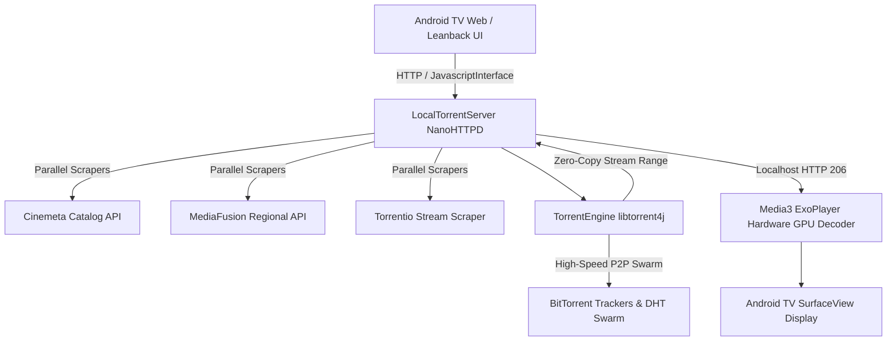

# StreamBravia-TV ⚡

High-Performance Standalone Android TV Streaming Client with **Media3 ExoPlayer**, **Libtorrent4j Zero-Copy Hardware Acceleration**, **Voice Remote Search**, and **Instant Catalog Caching**.

Designed from the ground up specifically for **Android TV** and **Google TV** (API 26 to 34+).

---

## 🌟 Highlights & Key Features

- **🚀 Pure GPU Hardware Acceleration**:
  Powered by `androidx.media3.exoplayer` rendering directly into a native `SurfaceView` with hardware tunneling, strict aspect ratio preservation (`FIT` / `ZOOM` / `FILL`), and instant audio track selection.
- **⚡ Direct Swarm Streaming Engine**:
  Embedded `libtorrent4j` engine streaming verified video blocks directly to ExoPlayer over a local zero-copy HTTP range proxy. No waiting for multi-gigabyte files to download.
- **🎙️ Voice Remote Search**:
  Hold the voice/mic button on your Android TV remote or click the mic button on screen to speak. Search queries auto-populate, trigger instant search, and smoothly navigate focus to the first search result.
- **🎬 Regional Cinema Catalog**:
  Dedicated **Regional** section with fast filters for **Tamil** and **Telugu** cinema, sub-filtering by release years (2026, 2025, 2024, etc.), automatic metadata healing, and duplicate title card unification.
- **⚡ 0ms Instant Catalog Caching**:
  Stale-While-Revalidate caching pattern allows the home screen and movie posters to render **instantaneously (0ms)** upon launch while silently refreshing from Cinemeta/MediaFusion in the background.
- **🔄 Integrated OTA Updater**:
  Directly checks [GitHub Releases](https://github.com/renopraveen/StreamBravia/releases/latest) from within the app, displaying update notices, release changelogs, real-time download progress, and package installation.
- **🎮 100% Android TV D-Pad Optimized**:
  Full spatial D-pad navigation, automatic card focus, sticky navigation drawer, and TV-first UI layout.

---

## 🛠️ Architecture Overview



---

## 📦 Building from Source

### Prerequisites
- Windows PowerShell 5.1+ or PowerShell 7+
- Android SDK (Build-Tools 34.0.0, Platform API 34)
- JDK 17 or JDK 21

### Build APK
Run the included automated build script:
```powershell
.\build_apk.ps1
```
The output APK will be generated at:
```text
StreamBravia-TV\bin\StreamBravia-TV.apk
```

### Install to Android TV
To deploy directly over Wi-Fi ADB:
```powershell
.\install_to_tv.ps1 -DeviceIp "192.168.1.2:5555"
```

---

## 📱 System Requirements

- **Operating System:** Android TV 8.0 (API Level 26) or higher (tested up to Android TV 14 / Google TV)
- **Architecture:** ARMv7a (`armeabi-v7a`) or ARM64 (`arm64-v8a`)
- **RAM:** Minimum 1GB RAM (optimized with low-memory safeguards and frame-pacing)

---

## 👤 Author

Developed by **[renopraveen](https://github.com/renopraveen)** (`renopraveeen1@gmail.com`).
